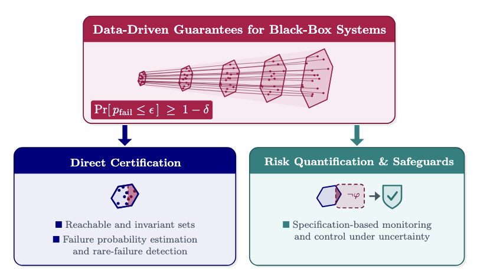

Catastrophic failures often arise from rare, low-probability events that extensive testing fails to expose. This challenge is amplified in safety-critical systems that rely on black-box components, such as deep neural networks or foundation models, which are high-dimensional, difficult to characterize, and cannot be certified with conventional, model-based verification methods.
Certifying such systems in practice therefore requires data-driven methods that quantify uncertainty and establish safety guarantees despite limited data.
<b>My research leverages statistical learning and formal methods to achieve data-efficient probabilistic guarantees and safeguards for black-box autonomous systems.</b>
To this end, I develop methods for (i) establishing finite-sample guarantees on system behavior and failure probabilities, and (ii) quantifying and mitigating risk in uncertain environments.

   

